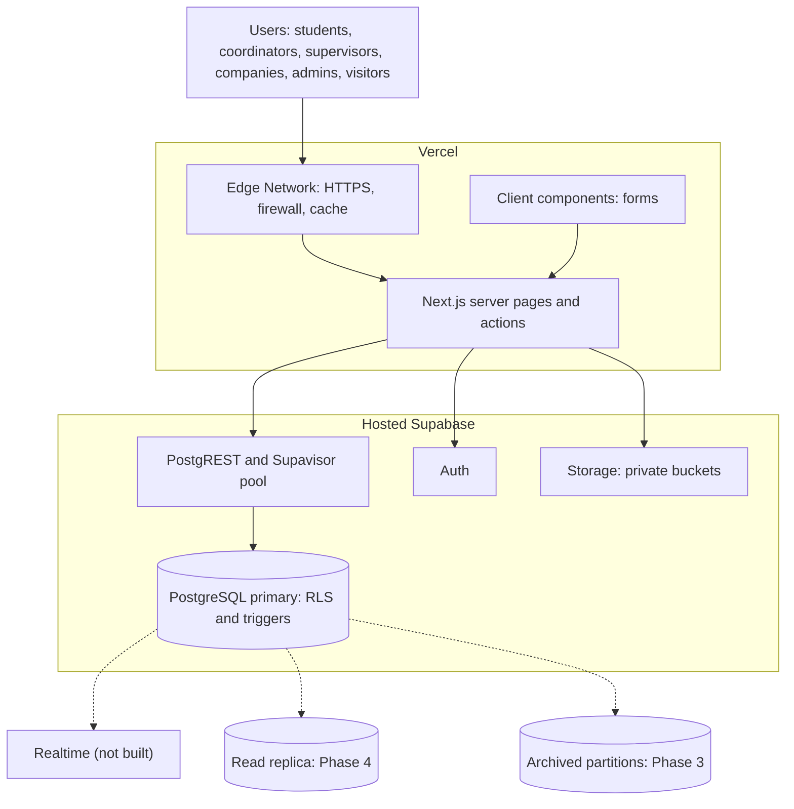
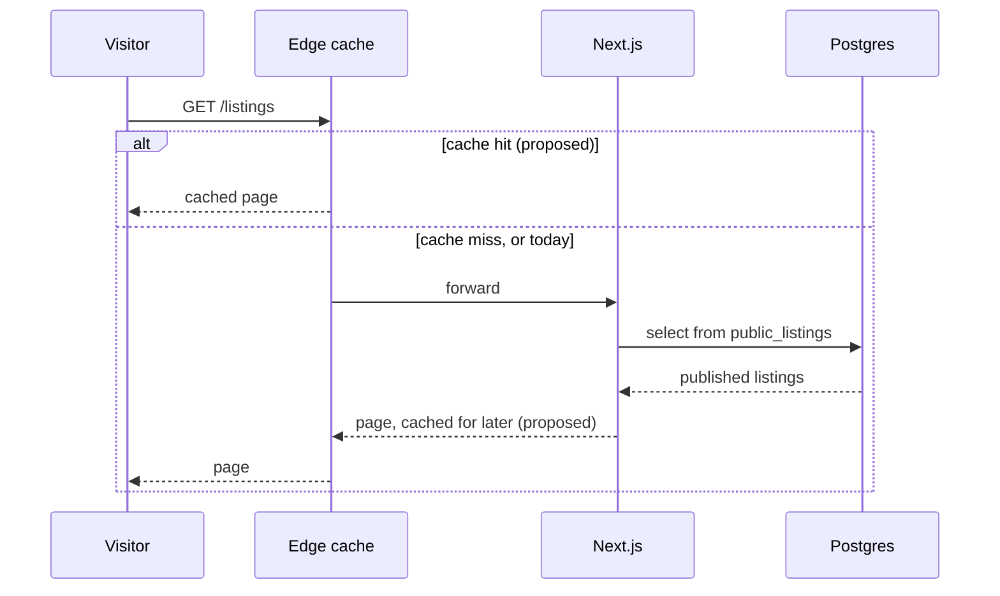
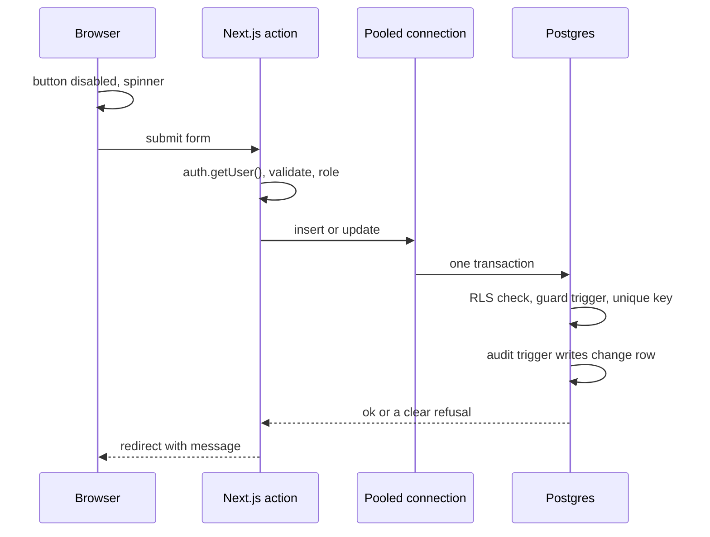
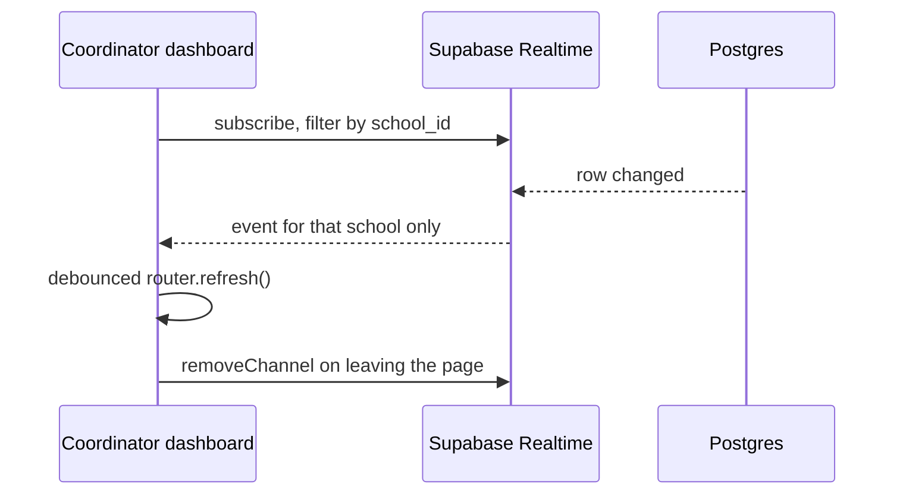
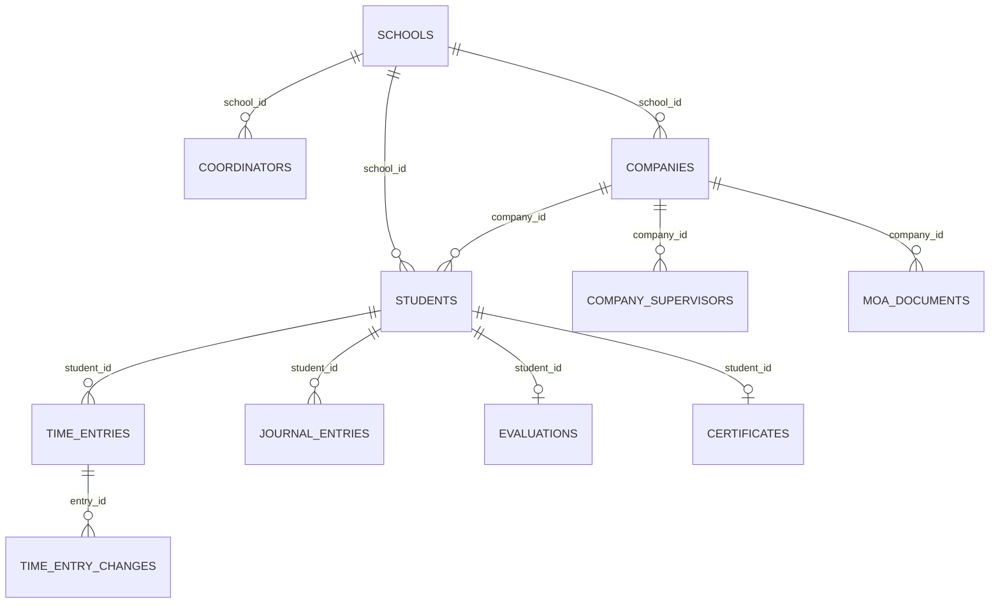
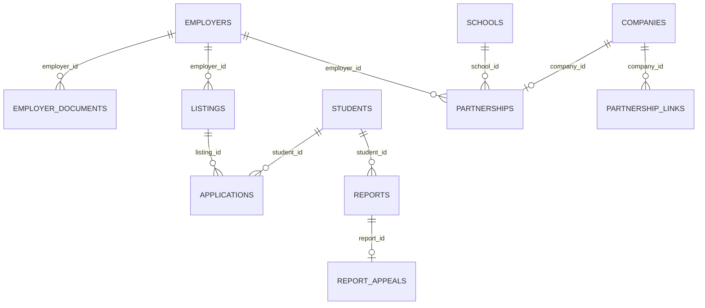
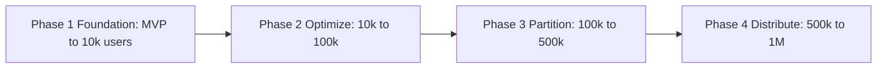

# Dugtong OJT: System Design Proposal for 1,000,000 Users

Status: proposal, October 2026. This is a document only. It changes no code, schema, RLS policy or migration. Every SQL block is marked "proposed — needs approval".

How to read the numbers: **Given** means it comes from the team's own architecture standard. **Measured** means it was read from the live repository or database for this document. **Estimate** means it is arithmetic on stated assumptions, not a fact.

---

## 1. Executive summary

The app can reach 1,000,000 users without changing its stack, because the web layer scales by itself and the real work is in the database. Dugtong OJT runs on Next.js on Vercel with a hosted Supabase PostgreSQL database behind it. Vercel adds capacity automatically when traffic rises, but one database holds all the data. Three kinds of tables will grow fastest: daily hours (`time_entries`), journals (`journal_entries`) and the change log (`time_entry_changes`). Each could reach tens of millions of rows per semester (Estimate, section 3). The plan keeps the pinned stack, fixes a small number of measured weak spots first (missing indexes, a login-matching lookup, an uncacheable public page), and then adds heavier tools (partitioning, a read replica) only when a measured trigger is reached. Any schema or RLS change needs team approval before it is run.

---

## 2. Goals, non-goals and assumptions

The goal is to stay fast and correct as schools join, without a rewrite.

**Goals**
- Serve 1,000,000 registered users, about 150,000 daily and about 10,000 at the same moment (Given).
- Keep the public OJT openings page under 1 second.
- Never create duplicate or lost writes during a burst of clicks.
- Keep each school's data private from every other school, and comply with RA 10173 (the Philippine Data Privacy Act).

**Non-goals**
- Features outside `docs/SPEC.md`, payments or billing, rewriting the app, and any infrastructure outside Next.js, Vercel and hosted Supabase (no Docker, Kubernetes, Nginx, self-hosted servers, external Redis or Kafka).

**Assumptions**

| Assumption | Value | Label |
|---|---|---|
| Registered users | 1,000,000 | Given |
| Daily active users | 150,000 | Given |
| Peak concurrent users | 10,000 | Given |
| Share of users who are deployed students in a semester | 30% | Estimate |
| Working days in a semester | 90 | Estimate |
| Installed framework versions | Next.js 16.4.0, React 19.3.0, supabase-js 2.117, @supabase/ssr 0.12 | Measured (`package.json`; the standard documents Next.js 15 as the target) |
| Schema size today | 23 numbered SQL files, about 25 tables | Measured |

---

## 3. Capacity estimates

At full scale, three tables reach tens of millions of rows per semester and the busiest minute is a morning rush of about 130 writes per second, which one well-sized Postgres database can handle.

| Item | Arithmetic | Result | Label |
|---|---|---|---|
| Deployed students per semester | 1,000,000 × 30% | 300,000 | Estimate |
| `time_entries` rows per semester | 300,000 × 90 days (one entry a day) | 27,000,000 | Estimate |
| `journal_entries` rows per semester | 300,000 × 90 days (worst case, one a day) | 27,000,000 | Estimate |
| `time_entry_changes` rows per semester | about one row per approval or rejection, so about 27,000,000 (more if decisions change) | about 27,000,000 | Estimate |
| `evaluations` | one per deployed student | 300,000 | Estimate |
| `applications` | about 3 per deployed student | about 900,000 | Estimate |
| `reports` | about 1% of deployed students | about 3,000 | Estimate |
| Morning peak writes per second | 20% of 300,000 = 60,000 students, each logs hours and a journal (2 writes) in a 15-minute window (900 s): 60,000 × 2 ÷ 900 | about 133 per second | Estimate |
| Supervisor approval peak | 27,000,000 ÷ 90 days = 300,000 decisions a day, done in a 2-hour window (7,200 s): about 42 decisions per second, each writing the entry and a change-log row | about 84 writes per second | Estimate |
| Storage growth per semester | hours 27M × 200 B ≈ 5.4 GB; journals 27M × 700 B ≈ 18.9 GB; change log 27M × 350 B ≈ 9.5 GB | about 34 GB, indexes included | Estimate (assumed row sizes) |
| Realtime connections at peak | none built today; if added, about 10,000 users × 1 channel | about 10,000 | Estimate |

**Target response times**

| Operation | Target |
|---|---|
| Public OJT openings page | under 1 second (edge cache) |
| Filtered openings query | under 10 ms (indexed) |
| Write action (log hours, journal, apply) | under 300 ms |

---

## 4. Traditional infrastructure vs. our managed stack

A traditional system needs load balancers and server fleets; ours gets the same jobs done by managed services, so the engineering effort goes into the database.

| Traditional component | What it does | Dugtong OJT equivalent |
|---|---|---|
| DNS and SSL termination | Routes the domain, secures HTTPS | Vercel domains with automatic SSL |
| Load balancer | Spreads traffic across servers | Vercel Edge Network routing to serverless functions |
| App server fleet | Runs the app, scaled by hand | Next.js on Vercel serverless functions, autoscaled and stateless |
| CDN or reverse-proxy cache | Serves cached pages | Vercel Edge cache and ISR (`revalidateTag`) |
| WAF or rate limiter | Blocks floods and bots | Vercel firewall plus server-action checks |
| Connection pooler (PgBouncer) | Shares database connections | Supabase Supavisor (transaction mode) and PostgREST |
| Primary database | Source of truth | Hosted Supabase PostgreSQL |
| Read replicas | Take heavy reads off the primary | Supabase read replica (Phase 4, needs approval and budget) |
| Cache cluster (Redis) | Hot-data cache | Edge cache for public data; indexes and Postgres for private data |
| Pub/sub or WebSocket servers | Live updates | Supabase Realtime (filtered changes and Broadcast); not built yet |
| Object storage | Files | Supabase Storage, private buckets, 60-second signed links |
| Auth server | Login and sessions | Supabase Auth |
| Job queue and workers | Background work | Postgres triggers and RPC functions, batched inserts |
| Monitoring stack | Metrics and logs | Supabase Query Performance (`pg_stat_statements`), Vercel logs, the `time_entry_changes` audit table |

The hosting layer scales on its own, so the work that matters is in the database.

---

## 5. High-level architecture

Every request goes browser, then Vercel, then Supabase, and only the last box (the database) is a single point that needs deliberate scaling.



**What each layer does**
- **Edge Network:** terminates HTTPS, blocks obvious floods, and can serve cached pages. Today only static files are cached; the pages are server-rendered per request (25 pages declare `force-dynamic`, Measured).
- **Next.js server pages and actions:** check who the user is (`auth.getUser()`), validate input, and call the database. They keep no state, so Vercel can run any number of copies.
- **PostgREST and Supavisor:** the app talks to Supabase over HTTPS, and Supabase pools the real database connections, so thousands of requests share a small fixed pool.
- **PostgreSQL:** holds the data and enforces the rules: Row Level Security, triggers, constraints. The app does not trust the browser for any total or permission.
- **Dashed boxes:** things that do not exist yet and only appear in later phases.

---

## 6. Request flows

### 6.1 Public OJT openings (read)

A visitor's request should usually end at the edge cache, but today it always reaches the database.



Today `/listings` always takes the "miss" path: the page reads the signed-in user's cookies (to show the Apply and partnership buttons), which makes Vercel treat every visit as unique (Measured: `src/app/listings/page.tsx`). The proposal in section 10 splits the public list from the per-user buttons.

### 6.2 A write during a burst (log hours or journal)

A write is checked three times (browser, server, database) so a double click or a slow network cannot create a duplicate or a lost update.



Real examples in the app: the guard triggers on `time_entries`, `journal_entries`, `applications` and `evaluations` fill in the school and the decision details themselves; the audit trigger writes to `time_entry_changes` inside the same transaction; a unique index refuses a second live application (`applications_live_idx`) and a second journal for the same day (`unique (student_id, work_date)`).

### 6.3 Live updates (proposed)

Live updates are not built today (Measured: no Realtime subscription anywhere in `src/`); if added, each dashboard should listen only to its own school's changes.



---

## 7. Data model

The data is already organised by tenant (`school_id`), which is exactly what makes it safe to scale and to partition.

**People, schools and daily records**



**Marketplace and protection**



**How each table will behave**

| Table | Tenant key | Pattern | Growth per semester | Scaling treatment |
|---|---|---|---|---|
| `time_entries` | `school_id` (through the student) | very high write, high read | about 27M rows | index trim, partition by `work_date` (Phase 3) |
| `time_entry_changes` | `school_id` | high write, rarely read | about 27M rows | partition by `changed_at`, archive (Phase 3) |
| `journal_entries` | `school_id` | high write, medium read | up to 27M rows | partition by `work_date` (Phase 3) |
| `students` | `school_id` | read-heavy, bulk insert | 300k | `email` index now |
| `applications` | `school_id`, `employer_id` | medium | about 900k | already indexed |
| `evaluations`, `certificates` | `school_id` | low write | about 300k | none needed |
| `listings` | `employer_id` | public read | small | edge cache the public view |
| `reports`, `report_appeals` | `school_id`, `company_id` | low | thousands | none needed |
| `partnerships`, `partnership_links` | `school_id`, `employer_id` | low | thousands | none needed |
| `moa_documents`, `employer_documents` | `school_id` / `employer_id` | low, plus files | thousands | `school_id` index on `moa_documents` |

---

## 8. Database scaling strategy

Most of the early gains come from five cheap changes to indexes and queries, not from new infrastructure. The first three below were found in the live database for this document.

**1. Row Level Security already uses the fast pattern.** RLS (Row Level Security) is a set of rules inside Postgres that decides which rows each user may see. A rule that calls `auth.uid()` or a helper once per row is slow at scale; wrapping it as `(select ...)` makes Postgres compute it once per query (an "initPlan"). A search of the 23 migration files found no policy that calls `auth.uid()` or a tenant helper without the wrapper (Measured, by text search, not a line-by-line audit). Proposed: a full policy audit in Phase 1 to confirm, owned by Khent.

```sql
-- proposed — needs approval
-- Pattern to keep using in every new policy:
using (school_id = (select current_school_id()))
```

**2. Fix the login-matching lookup.** Every student and supervisor screen first asks "which student row is me?" through `current_student_ids()` and `current_supervisor_company_ids()`. Both match the signed-in user's email to `students.email` and `company_supervisors.email`, but the only indexes on those tables start with another column (`students (school_id, email)`, `company_supervisors (company_id, email)`; Measured). With millions of students, each lookup may scan the whole table. This is the single most important fix.

```sql
-- proposed — needs approval
create index if not exists students_email_idx on students (email);
create index if not exists company_supervisors_email_idx on company_supervisors (email);
```

**3. Add the two foreign-key indexes that are missing, and remove two redundant ones** (Measured against the live database).

```sql
-- proposed — needs approval
create index if not exists companies_employer_idx on companies (employer_id);
create index if not exists moa_documents_school_idx on moa_documents (school_id);

-- Redundant (a longer index already starts with the same column). Every extra
-- index slows each write, and time_entries is the busiest table:
drop index if exists time_entries_student_idx;        -- covered by (student_id, work_date)
-- journal_entries has two indexes on (student_id, work_date): the unique one
-- and a second descending one; keep the unique one unless a query needs DESC.
```

**4. Replace "load everything" with cursor paging.** The Dashboard fetches every student of a school in batches of 1000 (`fetchAll`) and adds up the totals in JavaScript, then pages the list in the browser. That is fine for a school of a few thousand and wrong for a university system. Proposed: a database function that returns one page at a time using keyset (cursor) pagination, and totals computed by one SQL query. Keyset pagination remembers the last row seen instead of counting rows to skip, so page 400 is as fast as page 1.

```sql
-- proposed — needs approval (shape only)
-- where (name, id) > (:last_name, :last_id) order by name, id limit 25
```

**5. Keep one query per card, no queries inside loops.** The pages written for tickets 17 to 25 use one query per card, run in parallel; no per-row query loops were found in those pages (Measured, by reading them). Proposed: the same check on the older pages in Phase 1.

**6. Partition the three big tables (Phase 3).** Partitioning splits one huge table into smaller physical pieces, for example one per semester, so old data stays out of the way of new writes. `time_entries` and `journal_entries` would be split by `work_date`, and `time_entry_changes` by `changed_at`. Caution: Postgres requires the partition key inside every primary or unique key, and today `time_entries` has a primary key on `id` alone, so this needs an expand, migrate, contract rollout and a team decision (section 15).

**7. Archive old partitions.** After a retention period, detach an old partition and keep it read-only. Audit rows are never edited or deleted.

**8. Read replica for reports (Phase 4).** A replica is a read-only copy of the database. Only heavy reports and accreditation exports should use it; writes and live screens stay on the primary.

**9. Compute upgrades.** Move to a larger Supabase compute tier when CPU or memory at peak stays above the trigger in section 13. Prices are not quoted here because the team has not supplied them.

---

## 9. Concurrency and data integrity

The app already blocks most duplicate and lost-write problems in the database, not in the browser.

| Failure | Example | Safeguard today |
|---|---|---|
| Double submit | A student taps "Submit journal" five times | One journal per day (`unique (student_id, work_date)`); one live application per listing (`applications_live_idx`); one appeal per report; one partnership per pair |
| Lost update | Two requests change hours or slots at once | Hour totals are computed in Postgres (`student_hours` view and guard triggers), never sent from the browser |
| Client-computed totals | A browser sends "I worked 400 hours" | The database adds up approved entries itself; the certificate trigger refuses if hours are short |
| Partial write | An entry changes but its log row is lost | The audit trigger runs in the same transaction as the change |
| Connection starvation | Many roster uploads at semester start | Requests go through PostgREST and Supavisor, which share a small pool; the CSV size limit is an open decision |
| Duplicate partnership | Two coordinators click at once | Unique index on `(school_id, employer_id)` |

A gap to close: the Approve, Reject, Apply and Accept buttons use plain form actions without a "pending" state, so a user can click twice. The database stops the duplicate, but the user sees an error on the second click. Proposed: disable the button on submit (owner: Neil, for the shared pattern).

The rule that holds everything together: validate on the server, do the math in Postgres, and let constraints be the last line of defence.

---

## 10. Caching strategy

The public openings page is the only large cache opportunity, because everything else is private to one school.

| Layer | What is cached | How it refreshes | Database load |
|---|---|---|---|
| Browser | Fonts, CSS, scripts | Content-hashed file names | none |
| Vercel Edge and ISR | Public openings list (proposed) | `revalidateTag("listings")` when a company publishes, closes or edits an opening | one query per change, not per visitor |
| Authenticated screens | nothing shared | Rendered fresh per user | one set of indexed queries per page |

**The cookies trap.** In Next.js, reading the signed-in user's cookies makes a page "dynamic", and Vercel will not cache it. `/listings` does this today because it shows buttons that depend on who is signed in. Proposed: render the list of openings from a cookie-free server component (using only the public view `public_listings`) and tag it for revalidation, and show the Apply and partnership buttons in a small separate piece that does read the session. Private data must never enter a cached page.

---

## 11. Realtime scaling

Realtime is optional; the app works today with page loads, and live updates should only be added where they save real effort.

If added: each role subscribes only to its own tenant (coordinator by `school_id`, supervisor by company, student by their own id), every subscription is removed when the page closes (`supabase.removeChannel`), and incoming events trigger one debounced refresh instead of a reload. For the public openings page with thousands of viewers, use ISR or Broadcast, not a per-viewer database subscription, because each subscription runs the RLS rules and costs CPU. Estimated peak is about 10,000 connections (section 3).

---

## 12. Security and privacy at scale (RA 10173)

Scaling must not weaken the privacy rules, so every scaling step is checked against them.

- **Two checks on every request:** the server action confirms who the user is, and Postgres RLS confirms the tenant (`school_id`, company or student). Both must pass.
- **New tables and partitions get RLS.** A partition does not inherit policies in every case; each new partition, view and replica path is tested before use.
- **Edge cache holds only public listing fields:** company name, a "verified" label, course, slots, hours, schedule, city, role title and the scope of tasks (the fields of `public_listings`). Never contact details, documents or students.
- **Files stay private:** documents and MOAs are in private buckets and open only through 60-second signed links, scoped by folder.
- **Audit data stays tamper-evident:** archived change rows remain read-only; no role can update or delete them.
- **No secrets in the project:** no `service_role` or `sb_secret_` key in the repository or the browser; only the Supabase URL and publishable key are public.
- **Test across every role** (visitor, student, coordinator, supervisor, company, admin) after every scaling change.

---

## 13. Phased scaling roadmap

Work is staged by measured triggers, so the team spends effort only when the numbers ask for it.



| Phase | User range | Trigger to start (proposed) | Actions | Proposed owner |
|---|---|---|---|---|
| 1. Foundation | MVP to 10k | Now | Add `students.email` and `company_supervisors.email` indexes; add missing FK indexes; drop redundant indexes; audit all RLS policies; pending state on action buttons | Khent (RLS, indexes), Neil (buttons) |
| 2. Optimize | 10k to 100k | p95 query time above 100 ms, or database CPU above 60% at peak | Cursor-paged Dashboard list with SQL totals; ISR cache for public openings; batched roster import; first compute upgrade; BRIN indexes on time columns | Arwin (list, import), Josiah (cache) |
| 3. Partition | 100k to 500k | `time_entries` or `journal_entries` above about 10M rows | Partition by semester or month; archive old partitions | Arwin and Khent |
| 4. Distribute | 500k to 1M | Read load still high after Phase 3 | Read replica for reports; further compute upgrade | Team lead |

Thresholds and owners are proposals; the team should adjust them.

---

## 14. Monitoring

You cannot scale what you do not measure, so someone has to look at four dashboards on a schedule.

| What to watch | Where | When | Who (proposed) |
|---|---|---|---|
| Slowest and most frequent queries | Supabase Query Performance (`pg_stat_statements`) | Weekly, and after each release | Khent |
| Database CPU, memory, connections | Supabase reports | Daily at the 8:00 AM and Friday afternoon peaks | Team lead |
| Function duration and errors | Vercel logs | After each deploy, and at peaks | Josiah |
| Table sizes | A size query on the three big tables | Start and end of each semester | Arwin |

---

## 15. Risks and open decisions

The main risk is doing a heavy change (partitioning) before a cheap one (an index) would have been enough.

| Risk | Effect | Mitigation |
|---|---|---|
| Email lookup scans a large table | Every student and supervisor page slows as users grow | Phase 1 email indexes |
| Public page can never be cached | Every visitor hits the database | Split the cached list from per-user buttons |
| Partitioning needs a key change on `time_entries` | Risky migration | Expand, migrate, contract; rehearse on a copy; team approval |
| Dashboard loads all rows of a school | Slow for very large schools | Cursor paging and SQL totals |
| Double-clicks reach the database | Confusing error messages | Pending state on action buttons |
| Cost of larger compute is unknown | Budget surprise | Team lead sets a budget and the trigger metric |

**Open decisions (not decided here)**
- [ ] Partition keys and the semester definition: Arwin and Khent.
- [ ] How long to keep data before archiving: team lead and Khent.
- [ ] CSV roster size and row limits, and rules for partial imports: Arwin.
- [ ] Whether roles stay in tables or move into session claims: Khent.
- [ ] Whether to cache the public openings list, and what the cached page may show: Josiah and Neil.
- [ ] Compute budget and the metric that triggers an upgrade: team lead.
- [ ] Whether live updates are worth building at all: Josiah and Neil.

---

## 16. Glossary

- **BRIN index:** a very small index for columns that grow in order, like dates; good for huge logs.
- **CDC (change data capture):** the database announcing each row change; Supabase Realtime uses it.
- **Cursor (keyset) pagination:** paging by remembering the last row seen, so deep pages stay fast.
- **Edge cache:** a copy of a page stored near the visitor so the app does not rebuild it.
- **GIN index:** an index for columns that hold lists of values.
- **Idempotency:** doing the same action twice has the same effect as doing it once.
- **initPlan:** Postgres computing a value once per query instead of once per row.
- **ISR (incremental static regeneration):** a cached page that is refreshed only when its data changes.
- **Partitioning:** splitting a very large table into smaller physical pieces, for example by semester.
- **PostgREST:** the service that turns database tables into the HTTPS API the app calls.
- **Read replica:** a read-only copy of the database that takes heavy reads off the main one.
- **RLS (Row Level Security):** rules inside Postgres that decide which rows each user may see.
- **Supavisor:** Supabase's connection pooler, which lets thousands of requests share a few database connections.
- **Tenant:** one school (or company) whose data must stay separate from all others.
